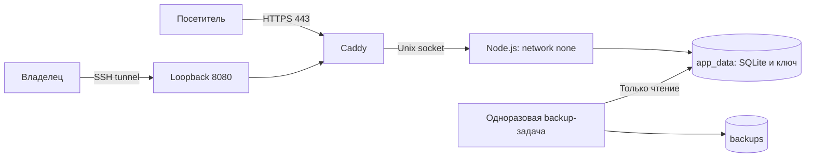
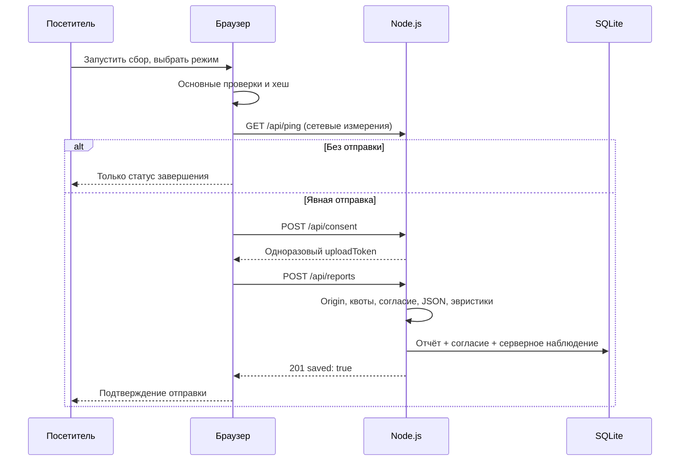

# Архитектура

[Оглавление](README.md)

## Состав

Приложение состоит из статического браузерного интерфейса и одного Node.js-процесса. Node обслуживает только разрешённые статические пути, HTTP API и SQLite. Стороннего backend-фреймворка, npm-библиотек, внешней базы и очереди нет.

| Модуль | Ответственность |
| --- | --- |
| `server.mjs` | Маршруты, HTTP-ограничения, Origin/CSRF, выдача cookie, lifecycle процесса |
| `security.mjs` | Проверка конфигурации, контекст клиента, квоты, сложность JSON |
| `database.mjs` | SQLite, ключ владельца, сессии, отчёты, поиск и очистка |
| `reports.mjs` | Нормализация отчёта и пересчёт эвристик |
| `connection.mjs` | Разрешённые заголовки и отдельное серверное наблюдение |
| `audit.mjs` | Структурированные события безопасности с ограничением частоты |
| `public/app.js` | Согласие, состояние сбора и отправка |
| `public/collector.js` | Основные и дополнительные браузерные проверки, хеш профиля |
| `public/behavior.js` | Счётчики событий вкладки без текста и сырых траекторий |
| `public/admin.js` | Вход владельца, список, детали и JSON-экспорт |
| `public/signals.js` | Общие эвристики автоматизации; импортируются и сервером |
| `public/field-info.js`, `public/table.js` | Справочник параметров и безопасный вывод значений |
| `public/consent.js` | Версия и текст согласия, общие для сервера и клиента |

## Production-топология

На VPS публикуются 80/tcp, 443/tcp и 443/udp. Порт 8080 привязан только к loopback VPS. Node не публикует TCP-порт и работает без сетевого интерфейса; Caddy получает доступ к socket-volume, но не к базе или ключу.

Caddy отвергает публичные административные пути и перезаписывает Host, X-Real-IP и схему для каждого входа. Node повторно проверяет origin точки входа и принимает proxy-наблюдения только через Unix socket. Произвольный клиентский XFF/CF-* не становится доверенным IP или bot score.

В dev-режиме Node слушает loopback TCP; кабинет и публичная страница находятся на одном origin. Это отдельный режим, не схема публикации.

## От сбора до SQLite

Серверное время согласия устанавливается при выдаче токена. Токен связан с origin и адресной группой клиента, живёт 10 минут и расходуется после успешной записи. Повтор одного и того же токена отклоняется. Токены и квоты находятся в памяти процесса; рестарт сбрасывает их.

Клиентские `signals` не считаются готовым вердиктом: сервер формирует их заново из нормализованных строк. При этом значения строк и `profile.hash` остаются данными клиента. Подтверждённые сервером наблюдения хранятся отдельно, а не подменяют клиентские строки.

## Вход и сессия

Ключ владельца случайный, его scrypt-хеш с солью хранится в SQLite. Вход проверяет квоты и допускает только одну дорогую проверку ключа одновременно. После проверки создание сессии ещё раз сверяет credential внутри SQLite-транзакции: смена ключа во время проверки не должна выдать сессию по старому ключу.

Session-токен случайный, хранится в БД как SHA-256; cookie HttpOnly и SameSite Strict. При HTTPS ставится Secure. На локальном HTTP-origin админки Secure отсутствует; внешний участок связи защищается SSH. CSRF-токен возвращается после входа/проверки сессии и требуется для изменения состояния владельца.

Браузер хранит CSRF в памяти. Ключ после попытки входа удаляется из поля формы. Просмотр, скачивание и хранение отчёта доступны только после серверной проверки сессии.

## Жизненный цикл и масштабирование

Статические файлы читаются в память при старте. После изменения backend или файлов интерфейса процесс нужно перезапустить; `npm run dev` делает это через Node watch.

Очистка по сроку запускается при старте и каждые 10 минут, до 500 отчётов за проход. Dev по умолчанию не очищает записи. SIGTERM/SIGINT прекращают приём соединений; через 10 секунд оставшиеся соединения принудительно закрываются.

Поставленная схема поддерживает один app-процесс. Горизонтальное масштабирование требует другого проектирования квот, токенов, сессий/хранилища и маршрутизации socket; простое увеличение числа контейнеров не поддерживается. Сетевой DDoS и защита самого VPS находятся за пределами приложения.

Связанные документы: [конфигурация](CONFIGURATION.md), [API](API.md), [модель данных](DATA-MODEL.md), [безопасность](../SECURITY.md).
